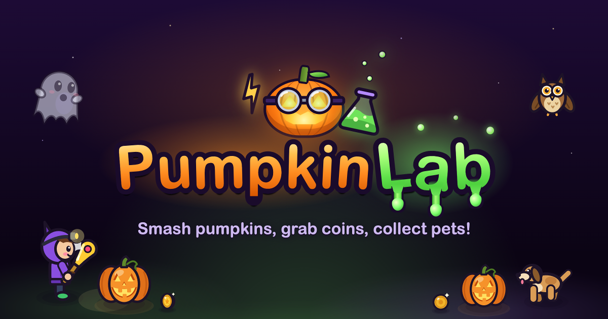
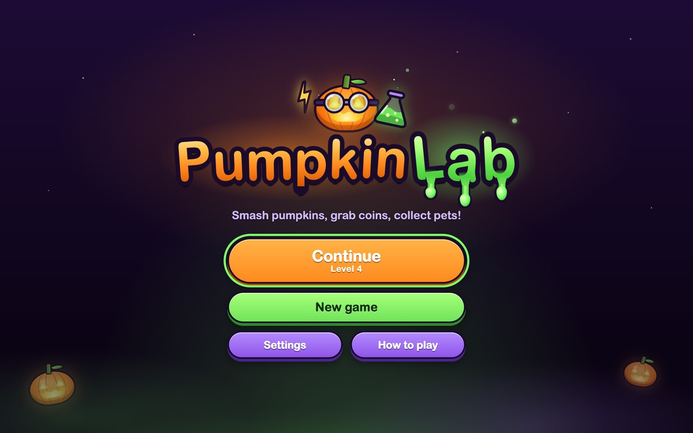
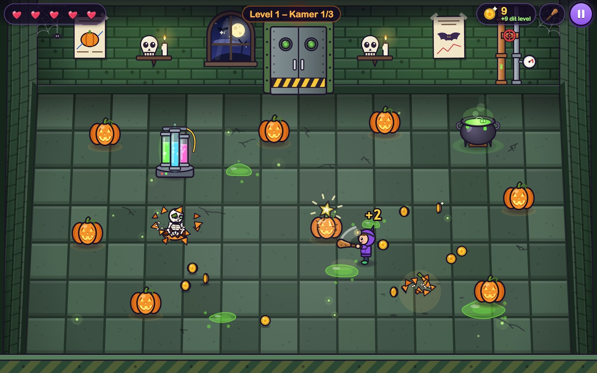
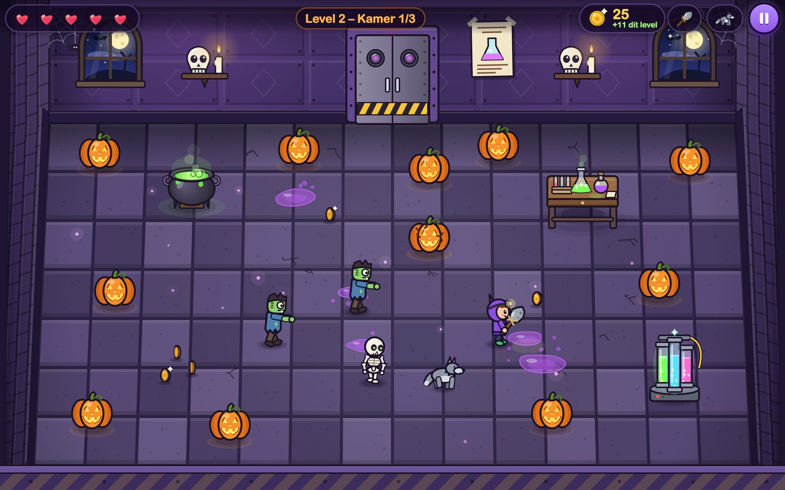
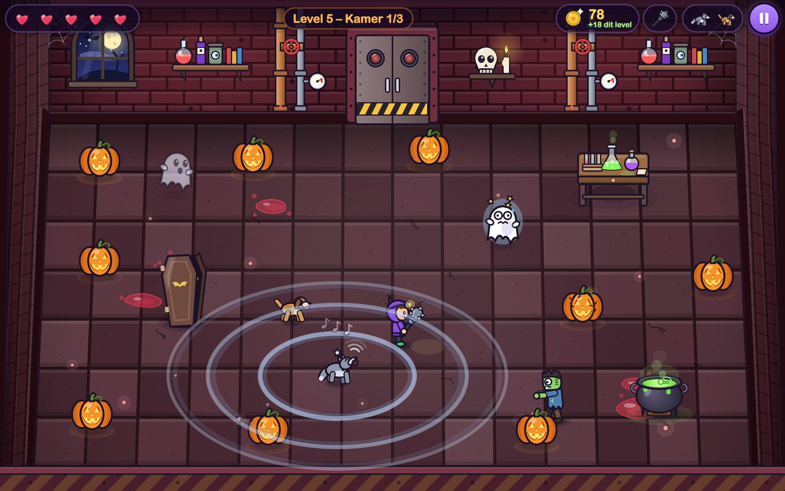
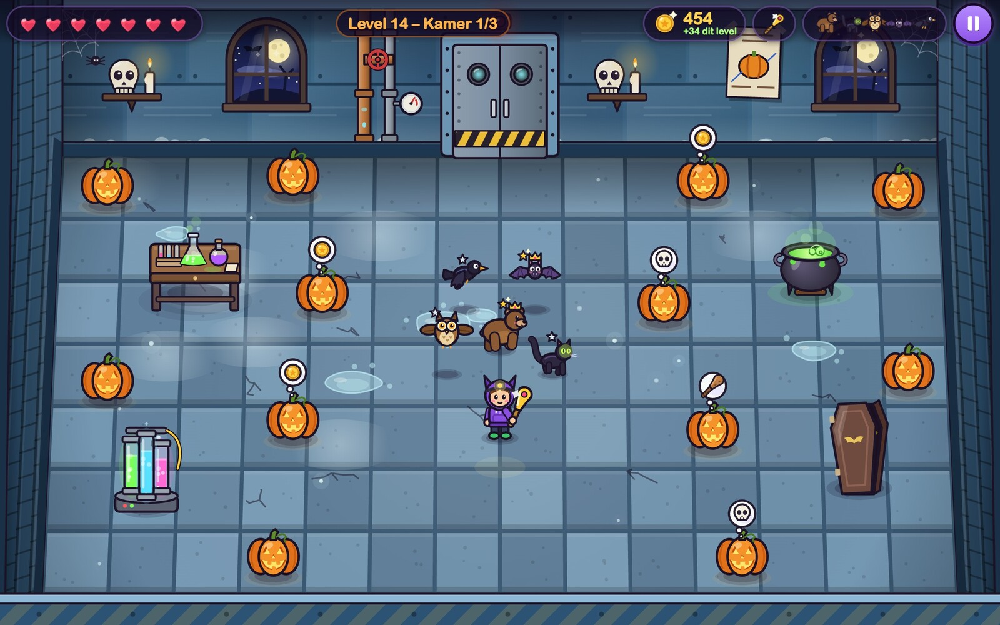
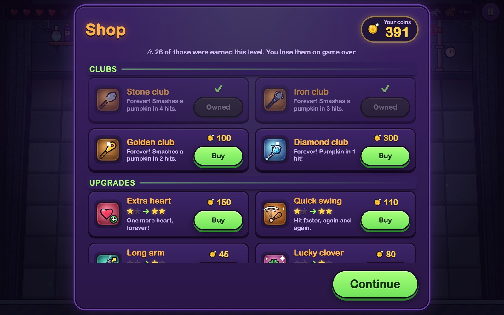
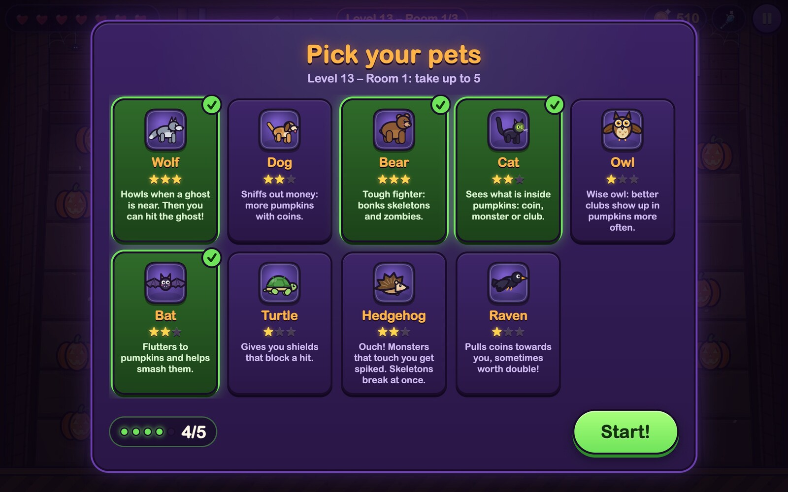
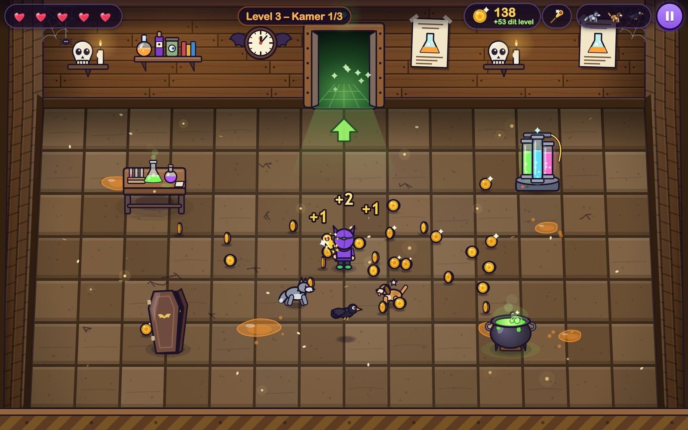
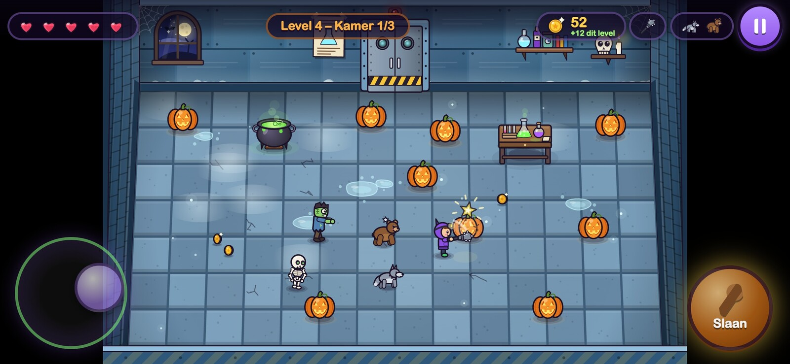

# PumpkinLab



A cheerful, spooky browser game for kids around 12 years old. You walk around a Halloween lab
(seen at an angle from above), smash pumpkins with your club, and pick up the coins. But watch
out: a skeleton, a zombie, or a ghost climbs out of some of the pumpkins!

- Every level has 3 rooms full of pumpkins: in level 1 there are 10, 12, and 14, and each level
  adds more (up to 30). Once all the pumpkins are smashed and all the skeletons and zombies from
  the pumpkins are defeated, the door opens.
- Every 5 to 10 seconds (on *Normal*), a monster climbs out of the floor on its own: usually a
  zombie, sometimes a skeleton, and from level 2 on, now and then a ghost. These monsters don't
  keep the door shut: you can also just leave them and run through the door.
- After every room and every level you visit the shop, which has four sections:
  - **Clubs**: stone, iron, gold, and from level 8 the diamond club (smashes a pumpkin in 1 hit).
  - **Upgrades** (forever): speedy shoes, quick swing, long arm (hit from further away),
    lucky clover (more coins per pumpkin), extra heart (up to 7), and an extra
    pet spot (4th spot from level 7, 5th from level 12).
  - **Pets**: make your pets stronger (level 1 → 2 → 3).
  - **Hearts**: refill a lost heart.

  Things that are still locked already show up with a lock icon and "From level X".
- A club from a pumpkin upgrades your club by one step, only for that level and at most up
  to gold.
- After level 1 you get the wolf, then a new pet every level (dog, bear, cat, owl,
  bat, turtle, hedgehog, raven). You take 3 of them into each room, or 4 or 5 with upgrades.
- You can only hit ghosts after the wolf has howled.
- Out of hearts? Then you restart the level and lose the coins you earned in that level.
- Beat 5 levels and you win; after that you can keep playing forever.
- Dutch and English, three songs (music and sound effects can be turned on/off separately), and
  progress is saved automatically (localStorage).

Everything (graphics and sound) is made in code. No libraries, no image or sound files, and no
build step needed.

## Screenshots

| | |
|---|---|
|  |  |
| The title screen | Smashing pumpkins: coins, and a skeleton climbing out |
|  |  |
| Zombies and a skeleton give chase, the wolf helps | The wolf howls, so the nearby ghost can be hit |
|  |  |
| Five pets at once; the cat shows what's inside the pumpkins | The shop between rooms |
|  |  |
| Picking which pets come along | Room cleared: the door opens and the coins fly to you |



*On a phone or tablet you play with a joystick and a hit button.*

### Images

Everything in [`media/`](media) may be used to write about the game:

- Avatar (1024×1024): [`avatar-emblem.png`](media/avatar-emblem.png) and
  [`avatar-wordmark.png`](media/avatar-wordmark.png) (with the name)
- Header / social image (1200×630): [`header-en.png`](media/header-en.png) and
  [`header-nl.png`](media/header-nl.png) (Dutch)
- Screenshots (1600 px wide) in [`media/screenshots/`](media/screenshots), with Dutch (`-nl`) and English
  (`-en`) versions of the title screen, the shop and pet selection

## Starting the game

The game uses ES modules, so it has to run through a (local) web server; opening the HTML file
directly won't work.

**macOS:** double-click `start.command`. A Terminal window opens with the server, and the game
opens in your browser. Close the window to stop. (Won't it open the first time? Then right-click
the file and choose *Open*.)

**By hand** (any system with Python 3), in this folder:

```sh
python3 -m http.server 8000
```

Then open http://localhost:8000 in your browser.

To play on a tablet or phone on the same Wi-Fi network: start the server with
`python3 -m http.server 8000 --bind 0.0.0.0` and open `http://<your-computer-ip>:8000`.

## Online

The current version runs at https://pumpkinlab.tomeij.net. Every push to `main` builds a Docker image
(nginx with `index.html`, `style.css` and `src/`; not `versies/`) and deploys it to the web server
(`.github/workflows/deploy.yml`).

## Controls

| Action | Keyboard | Touch (tablet/phone) |
|---|---|---|
| Walk | arrow keys or W A S D | joystick at the bottom left |
| Hit | space bar, Z, or J | *Hit* button at the bottom right (hold it down = keep hitting) |
| Pause | Esc or P | pause button at the top right |
| Menus | arrow keys + Enter/space bar, Esc = back | tap |

The mouse works everywhere in the menus. You'll find **Settings** (language, difficulty, song,
volume) on the title screen and in the pause menu. That's also where you can switch the game to
English, and where you'll find two switches: **Music on/off** and **Sound effects on/off**. They
are remembered, even if you open the game again later.

## Files

```
index.html            page with the canvas and the UI layer
style.css             styling for all menus, HUD, toasts, and touch buttons
DESIGN.md             game rules and agreements between the modules
start.command         macOS launcher (server + browser)
media/                avatar, header image, and screenshots (not part of the game)
src/
  config.js           all game numbers (balance, levels, pets, clubs, upgrades, spawner)
  main.js             starts everything up; window.pompoenlab = engine (handy for debugging)
  game/
    engine.js         main loop and game flow (title, levels, rooms, shop, game over)
    world.js          simulation of one room: player, hitting, coins, door, monsters that appear on their own
    room.js           builds a room (pumpkins, obstacles, wall decorations)
    draw.js           draws the world (y-sorted, shadows, effects)
    screen.js         canvas size, letterboxing, and sharpness on retina screens
    input.js          keyboard + touch combined
    monsters.js       skeleton, zombie, and ghost (behavior)
    pets.js           the 9 pets (behavior and bonuses)
  render/
    sprites.js        entry point for all drawing functions + icons for the UI
    art-room.js       floor, walls, door, wall decorations
    art-actors.js     player, clubs, monsters
    art-pets.js       pets
    art-props.js      pumpkins, obstacles, coins
    art-fx.js         effects (shards, little stars, howling, ...)
    art-util.js       shared drawing helpers
  ui/
    ui.js             all screens, HUD, toasts, and touch controls
    i18n.js           texts in Dutch and English
    save.js           saving and loading progress and settings
    shop.js           shop items (clubs, upgrades, pets, hearts) and buying
  audio/
    audio.js          WebAudio: music and sound effects (API for the rest of the game)
    music.js          the three songs
    sfx.js            the sound effects
    synth.js          synthesizer building blocks
```

## License

[MIT](LICENSE) © Roy Tomeij
